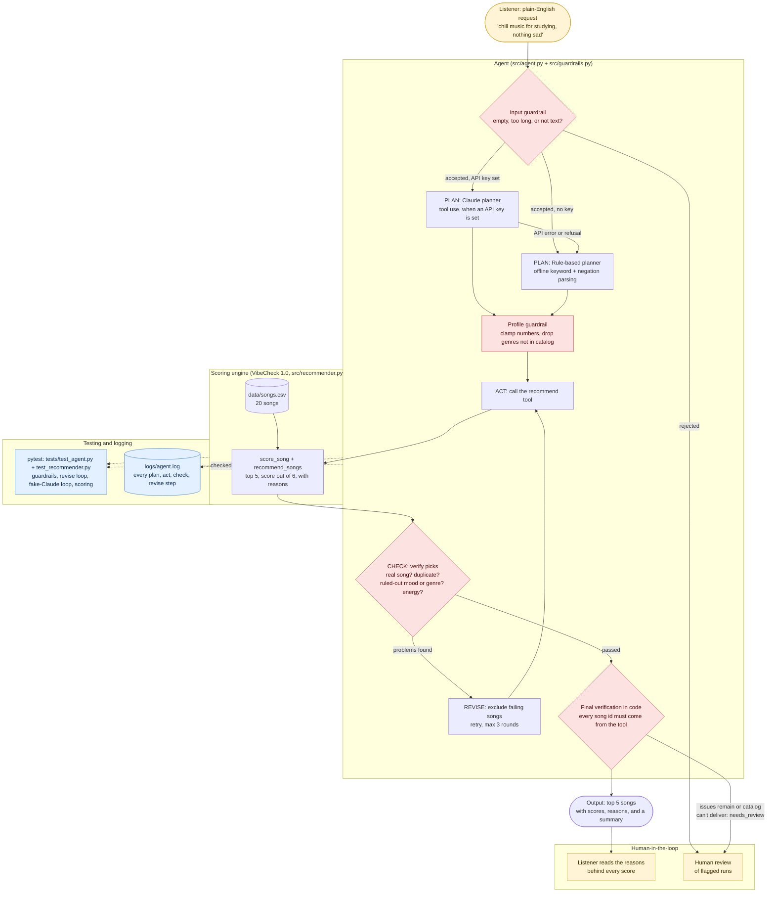

# 🎵 VibeCheck 2.0: An Agentic Music Recommender That Checks Its Own Work

Describe the music you want in plain English, like *"chill music for studying, nothing sad"*, and
VibeCheck returns five songs, each with a score and the reasons behind it. An AI agent turns the
request into a taste profile, runs a scoring engine as a tool, **verifies its own picks against what
you asked for**, and swaps out any song that breaks your rules before you see the list.

**Why it matters:** recommenders usually ask you to trust them. If you said "nothing sad" and a
sad song shows up anyway, a typical recommender gives no sign. VibeCheck treats the AI as a planner
whose output has to be checked: every recommendation is grounded in a real catalog, checked by code,
explained, and logged. When the catalog can't deliver what you asked for, the system **says so and
flags the run for a human** instead of quietly showing its best guess.

---

## Original Project: Music Recommender Simulation (VibeCheck 1.0, Module 3)

This project extends my Module 3 project, **Music Recommender Simulation (VibeCheck 1.0)**
([original repo](https://github.com/adonisadonisadonis1/ai110-module3show-musicrecommendersimulation-starter)).
VibeCheck 1.0 was a content-based recommender that scored a 20-song catalog against a hand-written
taste profile (favorite genre and mood, target energy and valence, acoustic preference) and printed
the top 5 songs, each with a score out of 6 and a reason for every point. Its goal was to show how
recommenders turn data into rankings, and to stress-test the scoring with adversarial profiles that
exposed biases like exact-label matching and genres missing from the catalog.

2.0 keeps that scoring engine unchanged and builds an agent around it. You type a request in plain
words instead of filling in a profile, and the agent plans, verifies and explains the results. The full 1.0 design write-up (weights,
data analysis, experiments) is in [docs/vibecheck_1.0_design.md](docs/vibecheck_1.0_design.md).

---

## Architecture Overview

The system has four parts, shown in the diagram below
(source: [`diagrams/architecture.mmd`](diagrams/architecture.mmd)):

1. **Guardrails** (`src/guardrails.py`) wrap the AI on both sides. On the way in, they reject empty,
   oversized, or non-text requests, clamp profile numbers into 0–1, and drop genres the catalog
   doesn't have. On the way out, they check every pick: is it a real song, is it a duplicate, does
   it have a mood or genre the listener ruled out, is its energy outside the requested range?
2. **The agent** (`src/agent.py`) runs a **plan → act → check → revise** loop. A planner turns the
   request into a profile plus constraints. The agent calls the scoring engine as a tool, checks the
   results, excludes failing songs, and tries again (up to 3 rounds). There are two planners:
   **Claude** (`claude-opus-5-5`, using tool use) when an API key is set, and an offline
   **rule-based planner** otherwise or if the API fails.
3. **The scoring engine** (`src/recommender.py`, unchanged from 1.0) ranks the 20 songs in
   `data/songs.csv` and explains each score. It's the only part that picks songs, so the AI can
   steer the search but can't invent results.
4. **Humans, tests and logs check the AI.** The listener sees the reasons behind every score.
   Runs that can't be fully satisfied are flagged with `needs_review` for a person to check. Every
   step is written to `logs/agent.log`, and a pytest suite covers the guardrails, the loop and the
   Claude integration.



### Project layout

| Path | What it does |
|---|---|
| `src/main.py` | Command-line entry point |
| `src/agent.py` | Agent loop, Claude planner, rule-based planner, tool wrappers |
| `src/guardrails.py` | Input validation, profile cleanup, output verification |
| `src/evaluate.py` | Reliability evaluation: 13 labeled requests with pass/fail criteria |
| `src/recommender.py` | VibeCheck 1.0 scoring engine, used as the agent's tool |
| `data/songs.csv` | 20-song catalog (17 genres, 16 moods) |
| `tests/` | `test_agent.py` (agent and guardrails) and `test_recommender.py` (engine) |
| `diagrams/architecture.mmd` | Mermaid source for the diagram above |
| `model_card.md` | Model card: intended use, limitations, evaluation, responsible-AI reflection |
| `docs/` | 1.0 design notes and phase 1 research |

---

## Setup Instructions

You need Python 3.9 or newer and git. Run every command from the project root.

1. **Clone the repo and enter it:**

   ```bash
   git clone https://github.com/adonisadonisadonis1/applied-ai-system-project.git
   cd applied-ai-system-project
   ```

2. **Create and activate a virtual environment:**

   ```bash
   python3 -m venv .venv
   source .venv/bin/activate      # Mac, Linux, Git Bash, WSL
   .\.venv\Scripts\Activate.ps1   # Windows PowerShell
   ```

3. **Install dependencies:**

   ```bash
   python -m pip install --upgrade pip
   pip install -r requirements.txt
   ```

4. **Optional: turn on the Claude planner.** Without a key, the offline rule-based planner runs
   and everything else (guardrails, checks, logging, review flags) works exactly the same.

   ```bash
   export ANTHROPIC_API_KEY="your-key-here"     # Mac or Linux
   $env:ANTHROPIC_API_KEY="your-key-here"       # Windows PowerShell
   ```

   Claude API calls are billed per use. To pick a different Claude model, set `VIBECHECK_MODEL`
   (the default is `claude-opus-5-5`).

5. **Run it:**

   ```bash
   python -m src.main "chill music for studying, nothing sad"   # one request
   python -m src.main "gym bangers, no metal" --steps           # also print the agent's steps
   python -m src.main --offline "happy acoustic songs"          # force the rule-based planner
   python -m src.main                                           # run four example requests
   python -m src.main --profiles                                # original 1.0 profile demo
   ```

   Every run adds its full step trace to `logs/agent.log`.

6. **Run the tests:**

   ```bash
   pytest
   ```

   The tests never call the real API. The Claude planner is tested with a scripted fake client, so
   no key or network is needed.

7. **Run the reliability evaluation** (13 labeled requests, printed as a markdown table):

   ```bash
   python -m src.evaluate
   ```

---

## Sample Interactions

These are real outputs from `python -m src.main --offline --steps "<request>"` (the rule-based
planner). With an API key set, Claude builds the plan instead, and the same code checks run on its answer.

### 1. A negative constraint the agent had to fix: "chill music for studying, nothing sad"

The planner reads "nothing sad" as a rule, not a preference: it rules out *sad* and the related
*melancholic*. The engine's first two attempts each included a song with a ruled-out mood. The
check step caught them, and the agent excluded them and tried again.

```
Request: chill music for studying, nothing sad
Profile: {'favorite_mood': 'chill', 'target_energy': 0.35}
Constraints: avoid ['melancholic', 'sad'], energy range [0.15, 0.55]
================================================================
Looked for a chill mood, low energy. Ruled out: melancholic, sad. Replaced 2 song(s) that broke your constraints.
Confidence: 0.82 (high)

1. Library Rain by Paper Lanterns  [lofi / chill]        Score: 2.50 / 6.00
     - mood match: chill (+1.0)
     - energy 0.35 vs your 0.35 (+1.50)
2. Spacewalk Thoughts by Orbit Bloom  [ambient / chill]  Score: 2.40 / 6.00
3. Midnight Coding by LoRoom  [lofi / chill]             Score: 2.40 / 6.00
4. Coffee Shop Stories by Slow Stereo  [jazz / relaxed]  Score: 1.47 / 6.00
5. Focus Flow by LoRoom  [lofi / focused]                Score: 1.42 / 6.00

Agent steps:
   1. [input] request accepted
   2. [plan] rule-based planner built a profile
   3. [act] called the scoring engine (round 1)
   4. [check] verified round 1        -> Grey Window: mood 'melancholic' was ruled out
   5. [revise] excluding 1 song(s) that broke a constraint
   6. [act] called the scoring engine (round 2)
   7. [check] verified round 2        -> Paper Boats: mood 'sad' was ruled out
   8. [revise] excluding 1 song(s) that broke a constraint
   9. [act] called the scoring engine (round 3)
  10. [check] verified round 3        -> passed
  11. [verify] final verification
```

*(Reasons are shortened after song 1. The check results on steps 4, 7 and 10 come from `logs/agent.log`.)*

### 2. Energy plus an excluded genre: "high energy songs for the gym, no metal"

"Gym" sets a high energy target (0.85) and an allowed range of 0.65–1.0. "No metal" becomes a
genre exclusion. The first round already passed every check, so no revision was needed.

```
Profile: {'target_energy': 0.85}
Constraints: avoid ['metal'], energy range [0.65, 1.0]
================================================================
Looked for high energy. Ruled out: metal.
Confidence: 0.95 (high)

1. Flamenco Fire by Lucia Torres  [latin / passionate]   Score: 1.50 / 6.00
2. Sunrise City by Neon Echo  [pop / happy]              Score: 1.46 / 6.00
3. Storm Runner by Voltline  [rock / intense]            Score: 1.41 / 6.00
4. Concrete Crown by Kilo Verse  [hip hop / confident]   Score: 1.40 / 6.00
5. Gym Hero by Max Pulse  [pop / intense]                Score: 1.38 / 6.00
```

### 3. A request the catalog can't satisfy: "k-pop music for dancing"

There is no k-pop in the catalog. The 1.0 engine would have scored "k-pop" with no warning and
returned weak matches that looked just as confident. In 2.0, the profile guardrail drops the unknown
genre (so it isn't treated as "pop"), the agent still uses "dancing" to target high energy, and the
run is **flagged for human review**.

```
Profile: {'target_energy': 0.85}
================================================================
Looked for high energy. Note: 'k-pop' is not a genre in the catalog, so it was dropped.
Confidence: 0.76 (high)

1. Flamenco Fire by Lucia Torres  [latin / passionate]   Score: 1.50 / 6.00
   ... (same high-energy songs as example 2)

!! Flagged for human review: the agent could not fully satisfy this request.
```

### 4. Input guardrail: an empty request

```
Request rejected: Request is empty. Describe the music you want, e.g. 'calm music for studying'.
!! Flagged for human review: the agent could not fully satisfy this request.
```

No planning or scoring runs.

---

## Design Decisions

**The scoring engine, not the AI, picks the songs.** I could have handed Claude the catalog and
asked for five songs. Instead, the AI only builds a *profile*, and the deterministic 1.0 engine
does the ranking. That keeps results reproducible and explainable (every point has a reason). It
also makes made-up songs impossible to show: the final check rejects any song ID that didn't come
from the engine. *Trade-off:* the AI can't recommend anything the scoring formula wouldn't rank, so
it can't pick up subtle vibes the formula misses.

**Code checks the final answer, whichever planner ran.** The same checks run on Claude's
submission and on the rule-based plan, and they run again at the end. Safety doesn't depend on
the model following its instructions. In testing, a submission containing a made-up song ID was
rejected and sent back to the model to fix.

**I wrote the tool-use loop by hand instead of using the SDK's automatic tool runner.** Each tool
call goes through my own code, so I can clean up inputs, record each step, and reject a bad
submission with a clear error message. *Trade-off:* more code to own.

**An offline fallback that is a real planner, not an error message.** Without a key, or when the
API fails or declines, the rule-based planner runs the same plan → act → check → revise loop. The
app always works, the tests are deterministic, and anyone can clone and run it for free.
*Trade-off:* keyword rules are brittle. They handle "nothing sad" and "no metal" but would miss
phrasing like "anything but country, please."

**Revise by excluding songs, not by changing weights.** When a song fails a check, the agent
removes it and asks the engine again, instead of changing the 1.0 weights mid-run. This keeps the
engine's behavior predictable and the log easy to read. *Trade-off:* up to 3 rounds, and since the
check runs on whole lists, a catalog with few valid songs can still come back short. That case is
reported as an issue and flagged.

**Flag for a human instead of guessing.** When a request names a genre the catalog lacks, or
contains no usable preferences, the system still shows its best attempt but marks the run
`needs_review`. A clear warning is more honest than a list that only looks confident.

**Python 3.9 compatibility.** My machine runs Python 3.9, so the code avoids newer syntax and
pins `anthropic==0.125.0`, the newest SDK that installs on 3.9.

---

## Reliability and Evaluation

**Summary:** 25 of 25 automated tests pass. On a 13-case evaluation set of typical, adversarial and
malformed requests, the agent went from **11/13 to 13/13 cases passed** (31/34 to
34/34 criteria) after the evaluation exposed two negation bugs and I fixed the
planner's negation rule. Average confidence rose from 0.55 to 0.6. The agent struggles
most when the catalog is thin: when only one song matches the requested genre, #1 is right but the
rest of the list is filler, and the confidence score drops below 0.5 to show it.

Four reliability methods work together:

| Method | What it does | Where |
|---|---|---|
| Automated tests | 25 pytest tests: guardrails, agent loop, negation parsing, confidence, the Claude loop (with a fake client), and the full evaluation set as a regression test | `tests/` |
| Evaluation harness | Runs 13 labeled requests through the whole agent and checks each against written pass/fail criteria. Prints a markdown table and can save JSON | `src/evaluate.py` |
| Confidence scoring | Every answer gets a 0–1 score; anything under 0.5 is flagged for human review | `confidence_score` in `src/agent.py` |
| Logging and error handling | Every step, check result, API error and fallback is written to the log, with the reason | `logs/agent.log` |

### Evaluation results

Reproduce with `python -m src.evaluate` (add `--json results.json` for structured output). These
are the results after the fix, using the rule-based planner, which is deterministic, so the
same table comes out every run.

| # | Test input | Type | Evaluation criteria | Result | Confidence |
|---|---|---|---|---|---|
| 1 | "chill music for studying, nothing sad" | typical | returns 5 songs; no sad/melancholic songs; all energy 0.0-0.65; #1 mood is chill | Pass | 0.82 |
| 2 | "high energy songs for the gym, no metal" | typical | returns 5 songs; no metal songs; all energy 0.55-1.0 | Pass | 0.95 |
| 3 | "happy acoustic songs for a summer road trip" | typical | returns 5 songs; #1 mood is happy; avg valence >= 0.6 | Pass | 0.66 |
| 4 | "sad songs for a rainy day" | typical | returns 5 songs; #1 mood is sad/melancholic; avg valence <= 0.5 | Pass | 0.55 |
| 5 | "romantic r&b for a date night" | typical | returns 5 songs; #1 is r&b | Pass | 0.20 |
| 6 | "angry metal for lifting weights" | typical | returns 5 songs; #1 is metal | Pass | 0.37 |
| 7 | "anything but country, please" | adversarial: negation phrasing | returns 5 songs; no country songs | Pass | 0.72 |
| 8 | "I don't want anything too intense, just relaxing jazz" | adversarial: negation phrasing | returns 5 songs; no intense/angry songs; #1 is jazz | Pass | 0.46 |
| 9 | "no rock, no pop, something electronic and moody" | adversarial: multiple exclusions | returns 5 songs; no rock/pop songs; #1 is electronic | Pass | 0.41 |
| 10 | "k-pop music for dancing" | adversarial: genre not in catalog | returns 5 songs; 'pop' not used as the genre; flagged for human review | Pass | 0.76 |
| 11 | "music" | adversarial: no preferences | returns 5 songs; flagged for human review | Pass | 0.73 |
| 12 | (empty) | malformed: empty | rejected before planning, no songs; flagged for human review | Pass | n/a |
| 13 | "xxxxxxxxxxxxxxxxxxxx... (600 chars)" | malformed: too long | rejected before planning, no songs; flagged for human review | Pass | n/a |

**Before the fix (11/13):** the two failures were both negation phrasings the planner didn't understand.

| # | Test input | Failure before the fix | Fix |
|---|---|---|---|
| 7 | "anything but country, please" | A country song (*Dusty Porch Swing*) was recommended | Added "anything but", "but not", "other than" and "apart from" as negations. A bare "but" is still not a negation, so "chill but upbeat" keeps *upbeat* |
| 8 | "I don't want anything too intense, just relaxing jazz" | "Intense" was read as a wish: *Storm Runner* and *Gym Hero* were recommended, and #1 was rock instead of jazz | Filler words between the negation and its target ("anything too") are now skipped |

### How confidence is scored

`confidence = (average score of the 5 picks) / (best possible score for the fields the profile uses)`.
That is then halved if any verification problem is left unresolved, and reduced 20% for each warning
(a dropped genre, or no clear preferences). A profile that only sets energy can score at most 1.5
points, so the score is measured against 1.5, not 6. Labels: high ≥ 0.75, medium ≥ 0.5, low < 0.5.
**Low-confidence runs are flagged for human review.**

What the scores showed:
- **Confidence measures how well the list matches the request, not whether it's correct.** Cases 5, 6, 8 and 9 all pass (the
  #1 song is right), but they score 0.20–0.46, because the catalog has only one r&b, metal, jazz or
  electronic song, so picks 2–5 are weak matches. Flagging these is useful: it tells the listener
  that most of the list is filler.
- **High confidence doesn't guarantee a good list.** "K-pop for dancing" scores 0.76 because the
  remaining preference (high energy) is easy to satisfy. That case is still flagged, by its warning
  rather than its score, which is why both signals matter.
- **9 of 13 runs were flagged for review:** 2 rejected inputs, 2 requests with nothing usable
  (k-pop, "music"), and 5 low-confidence results from thin genres. That's a high rate. It reflects
  the 20-song catalog more than the agent, and it would drop with a bigger catalog.

### Unit tests

| Area | What the tests check |
|---|---|
| Input guardrail | Empty, blank, non-text and over-500-character requests are rejected, and no recommendations are produced |
| Profile guardrail | Out-of-range numbers are clamped, and unknown fields and genres missing from the catalog (k-pop) are dropped with warnings |
| Output verification | Made-up song IDs, duplicates and ruled-out moods are each caught |
| Agent loop | "Nothing sad" really excludes sad and melancholic songs, the revise step actually runs, "no metal" holds, every song shown is a real catalog song, and k-pop is flagged instead of turning into pop |
| Negation parsing | "anything but country", "don't want anything too intense", "other than edm" and "but not too angry" all become rules, and "chill but upbeat" doesn't |
| Confidence | A perfect match scores 1.0, unresolved issues and warnings lower it, and low-confidence runs are flagged |
| Claude integration | With a scripted fake client: a submission containing a made-up song is rejected and the model's corrected answer is accepted, and an API failure falls back to the rule-based planner |
| Evaluation set | All 13 evaluation cases pass, so a fixed bug can't come back unnoticed |

### What didn't work, and what I learned

**Bugs found while building (by running the app; each fixed and now covered by a test):**
- **Reasons printed one letter per line.** The engine returns its reasons as one string, and I
  looped over it as if it were a list.
- **"k-pop" matched "pop".** My whole-word check treated the hyphen as a word break. I fixed it, and
  a test now checks that k-pop is flagged and never turns into pop.
- **"chill music for studying" chose the *focused* mood.** The planner preferred the longest
  matching keyword ("studying"). It now uses the word that appears first.
- **"high energy songs" treated "energy" as a genre name.** I added a list of common words that
  are never genres.

**What I haven't verified:** the live Claude path. Its loop logic is tested with the fake client,
but I haven't run it against the real API, so the quality of Claude's plans is untested. Also, the
rule-based planner gives "gym, no metal" and "k-pop for dancing" the same five songs, because both
come down to "high energy" when no genre or mood matches.

**What I learned:** most bugs showed up when I ran the app on realistic requests, not in my first
round of tests, and the evaluation set found two more that the unit tests missed. Every bug above became a test afterward. Testing the AI integration with a scripted
fake client was the most useful choice: it let me check how the system handles a made-up song, which
I couldn't count on the real model to produce on demand.

---

## Reflection

The most useful idea from this project was to stop treating the AI as the answer and treat it as one
step in a pipeline. The model's job became narrow (turn words into a profile), and everything around
it (the scoring engine, the checks, the review flag) is ordinary code I can test. That made the
system easier to trust, debug and explain. It also changed how I approach problems: before adding
intelligence, I now ask what has to be true about the output, and write that down as a check first.

The bugs taught me that small text-parsing details (a hyphen, the order of words) cause most real
failures, and that the honest response to "I can't do this" is a visible flag, not a confident guess.

My responsible-AI reflection (how I worked with AI on this project, a suggestion I accepted and one I
rejected or revised, and the system's limitations) is in the [model card](model_card.md).
